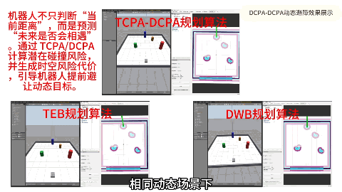
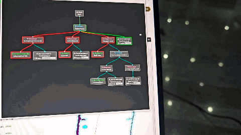
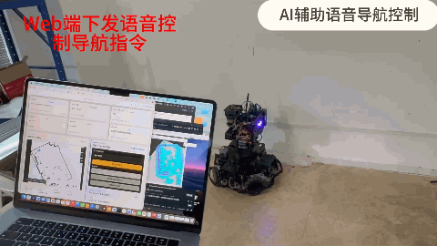
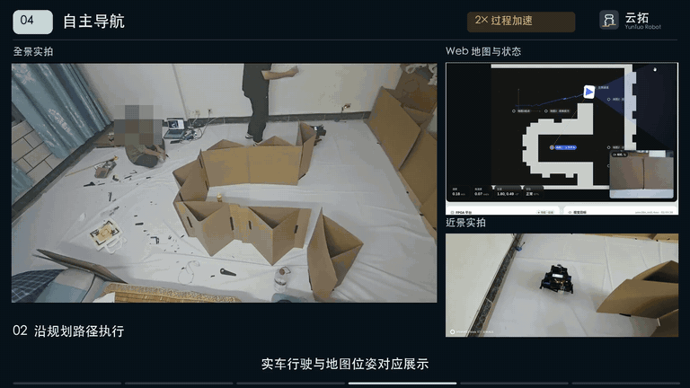

  

  <a href="mailto:20243007059@hainanu.edu.cn">Email</a>
  &nbsp;·&nbsp;
  <a href="https://github.com/LRaina215/SNAKE_TPCA-DCPA_NAV">Predictive Navigation</a>
  &nbsp;·&nbsp;
  <a href="https://github.com/LRaina215/HNU_NHS_SENTRY_UP">RoboMaster Sentry</a>
  &nbsp;·&nbsp;
  <a href="https://github.com/LRaina215/QHXD_Web">Multimodal Mobile Robot</a>
  &nbsp;·&nbsp;
  <a href="https://github.com/LRaina215/Yuntuo">YunTuo</a>

## About Me

我是海南大学信息与通信工程学院智能科学与技术专业本科生，研究与工程实践主要围绕**移动机器人自主导航、机器人视觉、自主决策、FPGA 软硬件协同与机器人系统集成**展开。

我关注算法在真实机器人系统中的完整落地——从感知、定位、规划与运动控制，到单片 FPGA 实时闭环集成、边缘多模态推理与多端交互联调。目前也在系统学习强化学习与具身智能，希望将已有的导航与系统工程能力持续拓展至更通用的智能体感知、决策与控制问题。

> Undergraduate in Intelligent Science and Technology at Hainan University, working on robotics, autonomous navigation, robot perception, decision-making, FPGA–edge co-design, and full-stack system integration.

## Research Experience

### 01 · Bio-inspired Snake Robot (National Innovation Project)

**面向三维复杂空间具备环境监测与自主运动能力的仿生机器蛇研发** · 国家级大学生创新创业训练计划 · 负责人 · [Navigation Module](https://github.com/LRaina215/SNAKE_TPCA-DCPA_NAV)

- 主导仿生机器蛇系统总体方案，融合环境感知、三维定位、自主导航与多步态运动控制，面向危险、狭窄且非结构化三维空间的监测与巡检。
- 提出利用蛇身与地面接触形成自支撑基座的构型构想，基于 **MuJoCo** 完成多版构型与步态仿真迭代，参与上管步态实机验证并负责运动学推导、步态示意图绘制与实验结果分析。
- 目前独立开展蛇形机器人**顺应性运动控制（compliant motion control）**方向研究；预测导航子课题已于 EI 会议发表（见 Research 02）。

### 02 · Predictive Navigation in Dynamic Environments

**面向动态环境的移动机器人平滑预测导航** · ACIRS 2026（EI 会议已发表，第一作者） · [Repository](https://github.com/LRaina215/SNAKE_TPCA-DCPA_NAV)

  

- 针对标准 DWB 在动态障碍前反应滞后与轨迹震荡问题，设计基于**常速度卡尔曼滤波（CV-KF）**动态障碍跟踪与 **TCPA/DCPA 各向异性时空风险场**的 Nav2/DWB 预测局部规划器。
- 引入**横向逃逸与方向翻转抑制机制**，构建 Gazebo 自动化评测脚本，围绕多类动态障碍遭遇场景与 TEB、标准 DWB 开展对比及消融实验。
- 在 50 组动态障碍对比测试中将导航成功率由 **60% 提升至 100%（+40 pp，仅风险场消融 88%）**，并在狭窄走廊与随机人群场景（各 20 组）完成泛化验证。

## Research Outputs

| Type | Work | Status |
| --- | --- | --- |
| Conference paper | *Anisotropic Spatiotemporal Risk Field for Smooth Predictive Navigation of Mobile Robots in Dynamic Environments* | ACIRS 2026 · published · first author |
| Invention patent | 移动机器人预测性导航与动态避障方法及系统 | published, under substantive examination · second inventor |
| Invention patent | 一种蛇形机器人从支撑平面挂载至悬空水平管道的方法及系统 | formally accepted · fourth inventor |

## Selected Projects

### 01 · RoboMaster Sentry Autonomy

**哨兵机器人自主决策、导航与视觉自瞄系统** · 全国大学生机器人大赛 RoboMaster 竞技奖 **国家级三等奖** · 导航与决策负责人 
[Navigation & Decision](https://github.com/LRaina215/HNU_NHS_SENTRY_UP) · [Vision & Auto-aim](https://github.com/LRaina215/HNU_NHS_SENTRY)

  
  &nbsp;
  

- 主导自主导航系统方案设计与实车联调，完成前端里程计 **Point-LIO**、点云地形分割（**Terrain Analysis**）、**ICP 全局重定位**及 **Theta\* / DWB** 规划控制的集成，针对 TF 变换、定位、代价地图与底盘控制链路开展实车联调与故障排查。
- 基于 **BehaviorTree.CPP** 融合下位机状态、自瞄目标与里程计信息，编写条件与动作节点，实现巡逻、追击、交战与低血量回防等动态战术决策。
- 搭建并改进 **ROS2 视觉自瞄系统**，完成装甲板识别、位姿解算、目标跟踪与上下位机通信联调，形成目标感知–战术决策–自主交战的实车闭环。

### 02 · Multimodal Inspection & Delivery Robot

**灵巡 · 多模态自主巡检配送机器人** · 中国机器人及人工智能大赛机器人创新赛 **国家级一等奖** · 上位机系统开发负责人 
[System Platform](https://github.com/LRaina215/QHXD_Web) · [Navigation](https://github.com/LRaina215/QHXD_NAV) · [Live](https://lingxunrobot.cn)（现网站已归属云拓）

  
  &nbsp;
  

- 基于 **RK3588 智能计算平台 + RT-Thread 实时控制器**协同架构，主导上位机总体设计与整车集成，打通导航、感知、任务管理、上下位机通信与多端交互链路。
- 集成 **Point-LIO** 前端里程计、**Theta\*** 全局规划算法与 **Omni PID Pursuit** 局部规划器，完成 URDF/TF 校准与 Nav2 参数调优，实现自主导航与多航点稳定巡检。
- 在 RK3588 端部署 **YOLO26、FunASR、DeepSeek 与 TTS**，实现视觉目标识别、巡检异常记录与视频回传，以及自然语言指令解析、任务确认与状态反馈。
- 开发 **FastAPI 后端、Cloud Gateway、Vue Web 与微信小程序**，基于 HTTPS/WSS 传输任务、导航与实时视频，并完成备案审核与公网上线。

### 03 · YunTuo Wheel-legged Robot

**云拓轮腿机器人：自主导航与具身智能的持续迭代实践** · 全国大学生嵌入式芯片与系统设计竞赛 FPGA 创新设计赛道 **国家级三等奖** · FPGA 导航与系统集成负责人 
[Project](https://github.com/LRaina215/Yuntuo) · [FPGA Navigation](https://github.com/LRaina215/SOC_FPGA_NAV) · [Edge Intelligence](https://github.com/LRaina215/QHXD_Web/tree/yuntuo-fpga) · [Live](https://lingxunrobot.cn)

  
   
  自主导航 · 视觉跟随 · 智能找物 ｜ <a href="https://github.com/LRaina215/LRaina215/releases/tag/yuntuo-v1.0-demo">完整演示（4 分 50 秒，含现场讲解）</a>

**V1.0** 基于**高云 GW5AT-LV138 FPGA + RK3588** 异构协同架构完成轮腿机器人原型，实现片上实时自主导航、视觉识别跟随及语音任务交互，并完成实车闭环验证：

- 自主设计并搭建基于 **RTL + PicoRV32 RISC-V 软核**协同的 FPGA 片内导航架构，构建“点云感知 → 融合定位 → 局部建图 → 路径规划 → 运动控制”片内链路，将固态雷达滚动高程建图、三维地形代价分析、结构匹配与局部轨迹评估实现为硬件模块，并与轮腿强化学习控制策略完成单片 FPGA 集成。
- 结合轮速、IMU 与 **SLF 匹配定位**进行位姿估计，通过 **Hessian 退化判别**抑制弱约束方向误修正；按雷达采集时刻对齐位姿，采用**先匹配、后融合**流程降低定位漂移与姿态突变对建图的影响。
- 实现记忆栅格与近场地图上的**分层 A\* 规划**，结合硬件批量轨迹评分、机体足迹及轮地支撑检查处理复杂地形约束，支持无图自主探索、先验图重定位、目标搜索跟随与受阻恢复。
- 在 **RK3588 本地离线部署多模态任务引擎**（量化版 YOLO26n、Qwen3-1.7B、SenseVoice 与 TTS），结合 RGB-D 实现目标检测与三维定位，支持语音找物、人员跟随、FPGA 自主执行及 Web 与微信小程序交互。

**后续 V2.0** 将基于现有平台重新设计四连杆轮腿结构，在整车结构定型后开展强化学习训练，结合训练与实机验证持续优化结构与运动稳定性，逐步实现倒地自启、跳跃等能力，并作为**视觉语言导航（VLN）**的学习与实验平台。

## Selected Honors

- 中国机器人及人工智能大赛机器人创新赛 · **国家级一等奖**
- 高教社杯全国大学生数学建模竞赛 · **国家级二等奖**
- 全国大学生机器人大赛 RoboMaster 竞技奖 · **国家级三等奖**
- 全国大学生嵌入式芯片与系统设计竞赛 FPGA 创新设计赛道 · **国家级三等奖**
- 海南大学 2024–2025 学年 · **一等奖学金**

## Technical Profile

| Area | Tools & Experience |
| --- | --- |
| Robot systems | ROS2, SLAM, Nav2, BehaviorTree.CPP, robot integration and debugging |
| FPGA & embedded | Gowin FPGA, Verilog RTL, RISC-V (PicoRV32), fixed-point hardware integration, RT-Thread |
| Simulation | MuJoCo, Gazebo |
| Programming | C/C++, Python, Verilog, Linux, Git |
| Vision & numerical tools | OpenCV, Eigen, NumPy, Matplotlib, PyTorch (basic) |
| System engineering | RK3588 (RKNN / RKLLM), FastAPI, Vue, WeChat MiniProgram, HTTPS/WSS, edge-cloud communication |
| Currently learning | Reinforcement learning fundamentals and embodied intelligence |

---

  欢迎就机器人自主导航、FPGA 软硬件协同、具身智能与机器人系统实践交流 · <a href="mailto:20243007059@hainanu.edu.cn">20243007059@hainanu.edu.cn</a>

